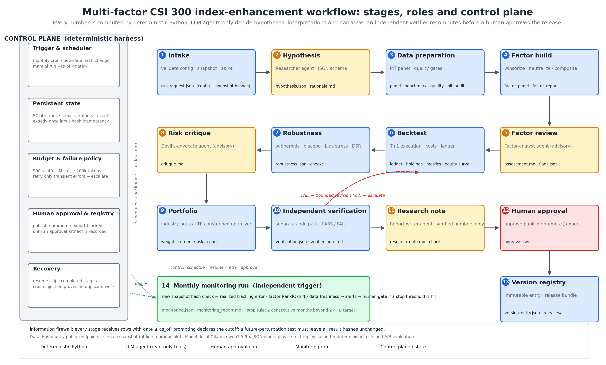

# Multi-factor CSI 300 index enhancement — a long-running agent workflow

**Author:** Zhengjia Zhu (student ID `25210660121`)
**Course:** AI Coding in Finance, Fall 2026 — Final Project
**Repository:** https://github.com/13162563982/aic-multifactor-index-enhancement
**Submission archive:** `25210660121-final-project.zip` (contains the complete `.git/` history)

This repository implements a long-running agent workflow for a substantial, recurring buy-side
task: **monthly multi-factor index-enhancement research on the CSI 300**. It connects
hypothesis generation, real public market data, factor construction, backtesting, robustness
checks, constrained portfolio construction, independent verification, human approval, version
registry and monthly monitoring. The workflow persists state in SQLite, resumes interrupted runs
without repeating completed work, prevents future-information leakage, and evaluates proposed
changes against a fixed baseline with recorded accept/reject and rollback decisions.

The financial content is real, not a toy: the frozen snapshot covers 300 CSI 300 constituents
with daily adjusted prices from 2016 and point-in-time financial statements. The numerical work
is deterministic Python; a local Qwen3.5 9B model is used only for hypothesis formation,
diagnostic interpretation, adversarial critique and report narrative. Every number that reaches
the report is produced by code and independently recomputed before a human can approve it.



---

## 1. Why this needs a persistent workflow

The desk runs a CSI 300 enhanced-index product. Every month the analyst must form a factor
hypothesis, refresh and clean data, rebuild factors, backtest, stress the result, construct a
tracking-error-constrained portfolio, get it verified and approved, write a note, and then
monitor the product until the next rebalance. Done manually this takes 3–5 analyst-days,
produces notebook results that cannot be reproduced a quarter later, and leaves no auditable
trail from data to approved weights.

A one-shot script cannot solve this because the task (1) recurs with new data and must remember
holdings, approved versions and monitoring history; (2) mixes deterministic calculation with
open-ended judgment; (3) needs a frozen baseline to decide whether a change is an improvement;
(4) fails routinely (data endpoints rate-limit, the model server is down, a run is interrupted);
and (5) gates consequential actions behind human approval and independent checks. The design
note in `docs/design_note.md` develops these points in full.

## 2. What one run produces

| Stage | Artifact | What it proves |
|---|---|---|
| Intake | `00_intake/run_request.json` | config, as-of date, snapshot hash and prompt hashes pinned |
| Hypothesis | `01_hypothesis/hypothesis.json`, `rationale.md` | a schema-valid, falsifiable factor hypothesis with a cutoff |
| Data | `02_data/panel.parquet`, `benchmark.parquet`, `data_quality.json`, `pit_audit.json` | point-in-time panel, quality gates, announcement-date audit |
| Factors | `03_factors/factor_panel.parquet`, `factor_report.json` | 13 raw factors, neutralised scores, IC diagnostics |
| Backtest | `05_backtest/ledger.parquet`, `holdings.parquet`, `metrics.json`, `equity_curve.csv` | costed monthly rebalance with a reconcilable ledger |
| Robustness | `06_robustness/robustness.json`, `robustness_checks.json` | sub-periods, costs, leave-one-out, placebo, bias stress, DSR |
| Portfolio | `08_portfolio/target_weights.parquet`, `orders.csv`, `risk_report.json` | industry-neutral, TE-constrained target and orders |
| Verification | `09_verification/verification.json`, `verifier_note.md` | independent recomputation and PASS/FAIL checks |
| Report | `10_report/research_note.md`, `charts/*.png` | committee-ready note built from verified numbers only |
| Approval | `11_approval/approval.json` | named human approval bound to artifact hashes |
| Registry | `12_registry/version_entry.json` | immutable version entry with rollback bundle |
| Monitor | `outputs/monitor/<id>/monitoring.json`, `monitoring_report.md` | realised TE, factor drift, data freshness, alerts |

## 3. Quick start

Requirements: Python 3.11+ on Windows, macOS or Linux. The test suite is offline; the default
run uses a committed data snapshot and a committed replay cache, so **no VPN, vendor account,
API key or GPU is required** to reproduce the submitted results.

```powershell
git clone <this repository>
cd aic-multifactor-index-enhancement
python -m pip install -r requirements.txt        # or: python -m pip install -e .

python -m pytest -q                              # offline test suite
python -m aicwf doctor                           # environment, snapshot, model checks
```

Reproduce the research package (offline, replay mode):

```powershell
python -m aicwf run --as-of 2026-11-12 --llm replay --run-id demo-2026-11-12
python -m aicwf approve demo-2026-11-12 --action publish_report --note "Reviewed the verification package"
```

Generate the evidence for interruption recovery, change control and monitoring:

```powershell
python -m aicwf fault-demo --as-of 2026-11-12        # crash after/before a stage, then resume
python -m aicwf eval --candidate v1.1.0 --baseline v1.0.0
python -m aicwf rollback --to v1.0.0
python -m aicwf monitor --as-of 2026-11-12 --llm replay
```

Optional: run the workflow with the real local model instead of the replay cache. This requires
[Ollama](https://ollama.com) with `qwen3.5:9b` pulled; the model is ~5.7 GB and runs on a laptop
GPU or CPU.

```powershell
ollama serve
python -m aicwf run --as-of 2026-11-12 --llm record --run-id live-2026-11-12
```

`--llm record` calls the real model and records each response in `evidence/llm_cache/`; later
runs can use `--llm replay` and get byte-identical artifacts.

## 4. Repository guide

```
├── README.md                     this file
├── docs/
│   ├── design_note.md            the required design note (task, architecture, operation, verification)
│   ├── architecture.png / .svg   annotated workflow diagram (generated by scripts/make_diagram.py)
│   ├── recovery_state.png        run state machine, crash recovery and escalation
│   ├── finance_methodology.md    factor, backtest, optimisation and robustness formulas
│   ├── artifact_contract.md      the artifact schema every subsystem follows
│   ├── operations_runbook.md     how to run, resume, approve, monitor and roll back
│   └── evidence_index.md         map from every claim in this README to a file in evidence/
├── aicwf/                        the workflow implementation
│   ├── contracts.py              stage names, statuses, per-run context, budget and fault contracts
│   ├── intake.py                 run validation and snapshot pinning
│   ├── controller/               SQLite state, DAG runner, retries, budgets, approvals, scheduler
│   ├── data/                     Eastmoney client, snapshot builder, quality gates, PIT auditing
│   ├── factors/                  factor library, winsorisation, neutralisation, diagnostics
│   ├── backtest/                 engine, costs, metrics, robustness suite
│   ├── portfolio/                projection, constrained optimiser, orders
│   ├── agents/                   LLM backends (Ollama / OpenAI-compatible / replay / null), runtime, stages
│   ├── verify/                   independent recomputation and verification checks
│   ├── registry/                 append-only versions, promotion, rollback
│   ├── eval/                     baseline A/B change evaluation
│   └── monitor/                  monthly monitoring and drift checks
├── config/                       workflow DAG, strategy, gates, budgets, model and data source config
├── prompts/                      role prompts for Researcher, Factor Analyst, Risk Critic, Report Writer, Verifier
├── skills/                       reusable skill files (hypothesis spec, factor diagnostics, PIT, report template, risk review)
├── data/snapshots/2026-11-12/    frozen real snapshot: prices, fundamentals, universe, benchmark, calendar, manifest
├── data/examples/                small CSV previews for human review
├── examples/demo_run/            a curated real run (small files only) for readers without Python
├── evidence/                     crash/resume, eval accept/reject, rollback, monitoring, replay cache, run logs
├── registry/versions.json        version history and release bundles
├── eval/baseline_v1.0.0.json     frozen baseline used for change control
├── scripts/                      snapshot builder, fixture generator, diagram generator, demo runner, ZIP packager
└── tests/                        offline unit and integration tests plus the deterministic mini snapshot
```

## 5. Design highlights

**Deterministic versus agent decisions.** Agents decide *what to test* and *how to explain it*;
code decides *what is true* and *whether a gate passes*. Agent outputs are JSON-schema validated,
and agent stages are advisory: a factor review or risk critique cannot change a number. The
report writer may only cite numbers present in verified artifacts.

**Persistent state and exactly-once resume.** `state/runs.db` stores runs, steps, attempts,
artifact hashes, budgets and approvals. A step is skipped only when the content hash of its
inputs matches the recorded hash. Interrupted runs re-run the affected stage and produce
identical artifacts; no completed stage is repeated and no side effect can duplicate an order.
`aicwf fault-demo` proves this with deliberate crashes (see `evidence/resume/`).

**Independent verification.** The verifier does not import the backtest engine. It rebuilds NAV
from the trade ledger and the price panel, recomputes every headline metric, reconciles cash and
shares, checks weight and industry constraints, audits announcement dates and price dates, and
verifies artifact hashes. A failure triggers at most two bounded revisions and then escalates.

**Human approval bound to hashes.** Publication, promotion and order export are blocked until a
human records an approval. The approval stores the hashes of the artifacts the human saw; if any
of them change, the gate re-blocks.

**Change control against a fixed baseline.** A candidate change (prompt, config or code) is
re-run on the frozen snapshot with the replay cache and compared with the baseline under
pre-registered hard gates and soft tolerances. Accepted changes are promoted to a new version;
rejected changes are recorded. Rollback restores the previous release bundle, re-runs a smoke
evaluation and appends an audit record.

**Leakage prevention in layers.** The snapshot is frozen and hash-pinned; the data stage rejects
rows after `as_of`; fundamentals are keyed by announcement date; signals execute at the next
close; agents have no network; the verifier audits dates; and a future-perturbation test replaces
post-`as_of` data with random values and asserts that every metric and artifact hash is unchanged.

## 6. Evidence

| Claim | Evidence |
|---|---|
| Full workflow runs end to end and produces a verified package | `examples/demo_run/`, `evidence/run/` |
| Interrupted runs resume without repeating completed work | `evidence/resume/` |
| Independent verification catches tampering and schema violations | `evidence/verification/`, `tests/test_verify_*.py` |
| Candidate changes are accepted/rejected against a fixed baseline | `evidence/eval/` |
| A promoted version can be rolled back with an audit record | `evidence/rollback/` |
| Monthly monitoring detects drift and enforces stop rules | `evidence/monitor/` |
| The real local model is used, with deterministic replay afterwards | `evidence/llm_cache/`, `evidence/run/llm_calls.json` |
| The submitted ZIP contains the complete Git history | `scripts/package_submission.py` self-check output in `evidence/package_check.txt` |

`docs/evidence_index.md` lists every claim with the exact file and, where relevant, the line or
JSON key to inspect.

## 7. Results

The latest verified run's headline numbers are in `examples/demo_run/05_backtest/metrics.json`
and are reproduced in the research note (`examples/demo_run/10_report/research_note.md`). The
numbers are generated by the deterministic engine, recomputed by the independent verifier, and
are **not** a production performance claim: the universe is the current CSI 300 membership, so
the backtest carries survivorship and reconstitution bias. The robustness stage quantifies part
of that bias with an adversarial stress test and the research note reports it.

## 8. Data sources and reproducibility

The snapshot is built from free, token-less public endpoints (Eastmoney) by
`scripts/build_snapshot.py`; the frozen copy is committed, so a reviewer does not need network
access. `data/snapshots/2026-11-12/manifest.json` records the source URLs, row counts, date
ranges and SHA-256 hashes of every file. Rebuilding the snapshot is a deliberate, verified action
and will not necessarily reproduce the same bytes because the vendor continuously revises data;
the committed snapshot is the reproducibility anchor.

The data is used for academic reproduction only. No client data, private data or credentials are
included. The `.env.example` file documents optional environment variables and contains no
secrets.

## 9. Limitations

* Survivorship and reconstitution bias from using current index membership.
* Vendor approximations (free-float weights, industry classification, occasional missing
  announcement dates handled with a documented 90-day fallback).
* One market and one historical period; no capacity, borrow or short-sale modelling.
* The local 9B model writes advisory prose only; its output is schema-checked and reviewed by a
  human, and all numbers are code-computed.
* Research prototype only: no broker connection, no live order routing.

## 10. Contribution

This is an individual project. I (Zhengjia Zhu) defined the task and user, the stage
decomposition, the factor and portfolio methodology, the verification checklist and the
change-control policy; I specified the interfaces and acceptance criteria, reviewed the
implementation, ran the verification and recovery evidence, and wrote the design note and
report. The code was developed with an agentic coding harness (DeepSeek Harness) under my
direction, with the deterministic/agent boundary, approval gates and verification protocol
designed explicitly to keep the model out of the measurement path. The repository history shows
the incremental development; prompts, skills and configs are included so the whole system is
reviewable without a hosted service.

## 11. Acknowledgements

Data: Eastmoney public endpoints (academic use). Local model: Qwen3.5 9B served by Ollama.
The workflow is implemented with Python, pandas, NumPy, SciPy, scikit-learn, PyArrow and
Matplotlib; diagrams are generated with Matplotlib by `scripts/make_diagram.py`.
