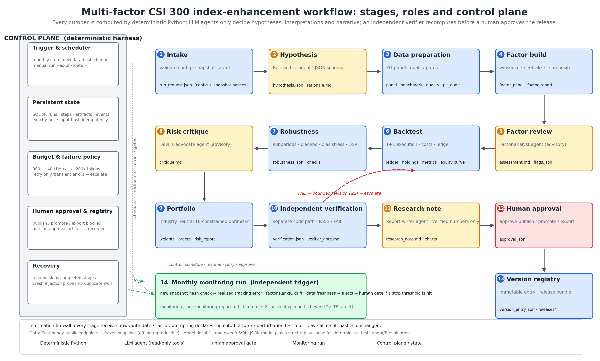

# Design note: a long-running agent workflow for multi-factor CSI 300 index enhancement

**Author:** Zhengjia Zhu (25210660121) · **Course:** AI Coding in Finance, Fall 2026
**Repository:** https://github.com/13162563982/aic-multifactor-index-enhancement

---

## 1. The task and the user

### 1.1 Intended user and work product

The intended user is a quantitative analyst on a China long-only index-enhancement desk at a
buy-side fund. The desk runs a CSI 300 enhanced-index product: it holds a portfolio that tracks
the CSI 300 closely enough to stay inside a tracking-error mandate, while tilting toward
compensated factors to earn a modest, repeatable excess return. The analyst's monthly job is to
decide the next target portfolio, justify it to an investment committee, and then monitor the
product until the next rebalance.

The recurring work product is a **monthly research and rebalancing package**:

1. a written research note with the hypothesis, factor evidence, backtest and robustness results;
2. a target-weight file and the associated order list, checked against liquidity and
   participation constraints;
3. an independent verification report that recomputes the numbers from the trade ledger;
4. a recorded human approval;
5. a versioned release entry that can be rolled back;
6. a monthly monitoring report that compares realised performance with the tracking-error
   target and flags factor or data drift.

The task is representative of buy-side quantitative research: hypothesis development, data
preparation, factor construction, backtesting, robustness checks, portfolio construction and
ongoing monitoring (the project brief lists exactly these stages). It is substantial — roughly
300 securities, 8.8 years of daily data, ~95 monthly rebalances and 13 candidate factors — and
it is genuinely repetitive: the same pipeline must run every month with new data, and the same
code must support ad-hoc research questions in between.

### 1.2 The current manual process

Today the analyst does the following, mostly by hand:

* **Data.** Downloads index composition, daily bars and financial statements from a free data
  portal into spreadsheets, pastes them into a research script, and manually reconciles field
  renames, stock-code changes and missing announcements. A single vendor field change can
  silently shift results by days of debugging.
* **Hypothesis and factor work.** Writes ad-hoc Jupyter notebooks. Factor definitions live in
  several notebooks, so the same "value" factor may be computed three slightly different ways
  across a quarter.
* **Backtest.** Runs a local script that is edited between runs. Results are pasted into slides.
  There is no fixed baseline, so a "better" result may simply reflect a different universe,
  cost assumption or date range.
* **Portfolio construction.** Solves a rough optimisation by hand-editing a target-weight
  spreadsheet: cap large names, zero out a few industries, adjust turnover. Constraint
  violations are found by inspection, not by code.
* **Verification and approval.** A senior colleague checks the numbers in a meeting. There is no
  independent recomputation, and the approval is an email thread. Nobody can prove afterwards
  which code and data produced an approved weight file.
* **Monitoring.** The analyst compares the product with the benchmark manually each month; the
  comparison is not linked to the approved portfolio, so attribution and drift analysis are
  re-done from scratch.
* **Interruptions.** When the laptop sleeps, the VPN drops or the data portal rate-limits, the
  script restarts from the beginning; the analyst has to remember which steps were already
  completed and whether partial outputs were overwritten.

The costs are concrete: about 3–5 analyst-days per month, repeated manual work, results that
cannot be reproduced six months later, no auditable trail from data to approved portfolio, and
no consistent defence against look-ahead bias when a new idea is tested. The desk also cannot
answer the investment committee's most basic question — "what exactly changed since the last
approved version, and did it help against a fixed baseline?" — without a week of archaeology.

### 1.3 Why this needs a persistent workflow, not a one-shot script

A single long prompt or a monolithic script cannot satisfy the task for five reasons.

1. **The task recurs with new inputs.** Each month brings a new trading day, new announcements
   and a new benchmark close. State must persist across months (previous holdings, last
   approved version, monitoring history, which data snapshot was used), or every run starts
   from zero and cannot compute turnover, tracking difference or drift.
2. **Different stages need different kinds of execution.** Numerical work — data cleaning,
   factor construction, backtesting, portfolio optimisation, verification — must be
   deterministic, testable and fast. Open-ended work — forming a hypothesis, interpreting weak
   evidence, writing the note, arguing against your own result — benefits from a language
   model. Mixing them in one prompt produces unverifiable numbers; separating them requires an
   orchestration layer that hands off typed artifacts.
3. **Change control requires a fixed baseline.** The desk proposes changes (a new factor
   definition, a different tracking-error target, a revised prompt). To accept or reject a
   change, the candidate must be evaluated against a frozen baseline on the same data and
   compared with a pre-registered tolerance. That is only possible if runs, configs, prompt
   versions and metrics are recorded and versioned.
4. **Failures are normal.** Free data endpoints rate-limit and disconnect; the local model
   server is sometimes down; a run can be interrupted at any point. A workflow needs
   checkpoints, idempotent steps, bounded retries, escalation rules and a resume path that
   provably does not repeat completed work or duplicate trades.
5. **Consequential actions need human gates and independent checks.** Publishing a research
   note, promoting a strategy version or exporting an order list are consequential. They must
   be blocked until a human approves them, and the numbers behind them must be recomputed by
   code that is independent of the code that produced them.

The workflow in this repository therefore treats the monthly package as a **long-running
research process** with persistent state, reproducible artifacts, independent verification,
human approval and monthly monitoring — not as a prompt.

---

## 2. Task specification

### 2.1 Stages, owners and artifacts

The workflow has thirteen stages. "Owner" distinguishes deterministic Python from LLM-agent
work; every stage is executed by the harness, and the LLM never controls execution.

| # | Stage | Owner | Purpose | Key outputs |
|---|-------|-------|---------|-------------|
| 01 | Intake | deterministic | Validate configuration and workflow DAG; pin the frozen snapshot; record provenance and information cutoff | `run_request.json` |
| 02 | Hypothesis | Researcher agent | Propose a falsifiable factor hypothesis with weights, constraints and a cutoff, validated against a JSON schema and the factor catalogue | `hypothesis.json`, `rationale.md` |
| 03 | Data preparation | deterministic | Enforce the as-of cutoff, build the point-in-time panel, run quality gates, audit announcement dates | `panel.parquet`, `benchmark.parquet`, `data_quality.json`, `pit_audit.json` |
| 04 | Factor build | deterministic | Compute 13 raw factors, winsorise, rank-standardise, neutralise industry and size, build the composite score | `factor_panel.parquet`, `factor_report.json` |
| 05 | Factor review | Factor-analyst agent | Read diagnostics, flag low coverage, collinearity, instability; advisory only | `assessment.md`, `flags.json` |
| 06 | Backtest | deterministic | Monthly rebalance, T+1 execution, costs, ledger, holdings, performance and benchmark metrics | `ledger.parquet`, `holdings.parquet`, `metrics.json`, `equity_curve.csv` |
| 07 | Robustness | deterministic | Sub-periods, cost sensitivity, leave-one-factor-out, parameter grid, seeded placebo, survivorship stress, deflated Sharpe ratio | `robustness.json`, `robustness_checks.json` |
| 08 | Risk critique | Risk-critic agent | Argue against the result with concrete evidence; advisory only | `critique.md` |
| 09 | Portfolio construction | deterministic | Industry-neutral, tracking-error-constrained optimisation, turnover cap, deterministic fallback, orders | `target_weights.parquet`, `orders.csv`, `risk_report.json` |
| 10 | Verification | independent deterministic code + Verifier agent | Recompute NAV, benchmark and metrics from the ledger and raw data; check bounds, neutrality, PIT, hashes; PASS/FAIL | `verification.json`, `verifier_note.md` |
| 11 | Report | Report-writer agent + deterministic charts | Write the research note from verified numbers only; charts produced by code | `research_note.md`, `metrics_table.md`, `charts/*.png` |
| 12 | Approval | human gate | Block publication/promotion/order export until an approval artifact is recorded | `approval.json` |
| 13 | Registry | deterministic | Append an immutable version entry with config, prompt and data hashes, metrics, verdict and approval | `version_entry.json`, `registry/versions.json` |
| 14 | Monitoring (separate trigger) | deterministic + agent summary | Track realised tracking error, factor drift, data freshness; stop rules and alerts | `monitoring.json`, `monitoring_report.md` |

### 2.2 Dependencies and parallelism

The dependency graph is fixed in `config/workflow.yaml` and validated at intake. The critical
path is `intake → hypothesis → data_prep → factor_build → backtest → robustness → portfolio →
verification → report → approval → registry`. The two advisory agent stages depend on the
deterministic stage they interpret and cannot block downstream computation. The report is only
released after verification; the registry entry only after human approval. Monitoring is an
independent monthly pipeline that reads the latest snapshot and the last approved version.

The runner executes stages in a deterministic topological order, which is sufficient for this
workload: the expensive steps (backtest, robustness) dominate, and reproducibility is worth more
than squeezing out parallelism. The design keeps stage boundaries clean so that independent
stages could be run in parallel later.

### 2.3 Triggers

* **Monthly schedule** — the production trigger, configured as `0 18 1 * *` in Asia/Shanghai,
  implemented through `scripts/scheduled_monitor.ps1` (Windows Task Scheduler) or cron. The
  message is a reminder to run the monitoring stage with the latest trading day; the domain
  calendar decides the actual rebalance day.
* **New-data trigger** — after a snapshot is refreshed, the harness compares the new
  `snapshot_hash` with the last monitored snapshot and starts a monitoring run (and, on a
  rebalance month, a full research run).
* **Manual research trigger** — an analyst runs `python -m aicwf run --as-of <date>` for an
  ad-hoc question, including `--as-of` dates in the past for walk-forward experiments.

### 2.4 Inputs and permitted sources

Runtime inputs are restricted to the repository: the frozen data snapshot, the configuration
bundle, the role prompts and skills, and artifacts from earlier runs in the same run directory.
The snapshot is built once by `scripts/build_snapshot.py` from free, token-less public endpoints
(Eastmoney for CSI 300 composition, daily adjusted bars, financial statements and industry
classifications). During a research run, **no agent and no stage may access the internet**, and
no credentials are required.

This separation matters for auditability: the data used by a run is identified by a SHA-256
manifest, not by "whatever the vendor returned at 9am". Rebuilding the snapshot is a deliberate,
separately verified action.

### 2.5 Information cutoffs and leakage control

* The run has a single `as_of` date, equal to the snapshot's as-of date.
* Every panel row must have `date <= as_of`; the data stage rejects and reports anything later.
* Fundamental values become usable only on their announcement date (`notice_date <= decision
  date`). When the vendor omits an announcement date, the workflow falls back to
  `report_date + 90 days` and flags the row as estimated.
* Signals are computed from month-end data and executed at the next close; the backtest never
  uses a signal and a return from the same date.
* Prompts state the cutoff explicitly and forbid using later information.
* Verification includes a future-perturbation test: replacing all data after `as_of` with
  random values must leave every reported metric and artifact hash unchanged.

### 2.6 Work products and acceptance criteria

A run is acceptable only if all of the following hold:

| Criterion | Threshold / evidence |
|---|---|
| Independent verification | `verification.json` verdict `PASS`; every required check `pass` |
| Metric reconciliation | Verifier recomputation matches reported metrics within 1e-6 relative tolerance |
| Portfolio constraints | Long-only, fully invested, per-name and active caps respected, industry active exposure ≈ 0, turnover ≤ limit |
| Tracking error | Realised/backtest tracking error within ±1% of the 5% target; ex-ante TE reported |
| Leakage | Future-perturbation and PIT checks pass; no row after `as_of` |
| Reproducibility | Same run id + snapshot + config + replay cache → identical artifact content hashes |
| Robustness | Report includes sub-periods, cost sensitivity, leave-one-out, placebo and bias-stress results; concerns are visible, not hidden |
| Cost and time | Run completes within the 900 s / 40 LLM calls / 200k token budget |
| Human approval | `approval.json` records approver, action, scope and artifact hashes before promotion or publication |
| Versioning | Registry entry records commit, config and prompt hashes, metrics, verdict and previous version; rollback is testable |

Monitoring runs have their own criteria: realised tracking error, tracking difference, factor
RankIC drift, data freshness and coverage are computed against the approved portfolio; a
breach raises an alert, and two consecutive months beyond twice the TE target stop new
rebalances until a human reviews the product.

### 2.7 What is deliberately out of scope

The project does not place orders or connect to a broker, does not consume real-time data,
does not train models, and does not claim production readiness. The data snapshot is for
academic reproduction only. The local 9B model is used for hypothesis, interpretation and
narrative text; every number in the package is computed by deterministic code and independently
recomputed.

---

## 3. Architecture

### 3.1 The picture

The annotated diagram (also available as `architecture.svg`; the state machine is in
`recovery_state.png`) has three layers.

* **Left: control plane.** The deterministic harness owns scheduling and new-data triggers,
  persistent state (SQLite), budgets and failure policy, the human approval gate, the version
  registry, and recovery. Nothing here is decided by a language model.
* **Middle: the stage DAG.** Blue boxes are deterministic Python; amber boxes are LLM-agent
  stages; the red box is the human gate; green is the independent monitoring run. Each box
  names the artifacts it writes, and each arrow is a typed handoff.
* **Bottom: the information firewall.** Every stage sees only data with `date <= as_of`, and
  the future-perturbation test proves it.

### 3.2 Roles and handoffs

| Role | Responsibility | Tools (mediated by the harness) | Input artifacts | Output artifacts | Why this role exists |
|---|---|---|---|---|---|
| Controller | Validate DAG, schedule stages, checkpoint, enforce budgets, retry, gate, record events | Its own deterministic code; no LLM | config, run request, state DB | state, events, escalation records | Execution control must be deterministic and auditable |
| Researcher agent | Propose a falsifiable hypothesis, factor weights, constraints, falsification tests and cutoff | `read_artifact`, `read_skill`, `submit_json` | config, factor catalogue, data summary, prior results | `hypothesis.json`, `rationale.md` | Hypothesis formation is open-ended; a schema keeps it bounded |
| Data steward (code) | Download once at build time; at run time enforce cutoff, quality gates, PIT rules | pandas/pyarrow | snapshot, config | panel, benchmark, quality, PIT audit | Data errors are the largest source of silent research failure |
| Factor analyst agent | Interpret coverage, IC, collinearity and stability; raise flags | `read_artifact`, `run_check` (whitelisted), `submit_json` | factor report, panel summary | `assessment.md`, `flags.json` | Diagnostics are numerous; narrative triage helps a human |
| Quant engine (code) | Factor computation, backtest, robustness, optimisation, metrics | pandas/numpy/scipy/sklearn | panel, hypothesis, config | factor panel, ledger, metrics, weights, orders | Numbers must be deterministic, fast and testable |
| Risk critic agent | Argue against the result; name concrete failure modes | `read_artifact` | robustness, metrics, critique history | `critique.md` | Adversarial review reduces confirmation bias |
| Independent verifier (code + agent) | Recompute and check; verdict PASS/FAIL; write the note | separate code path, read-only | ledger, panel, metrics, orders | `verification.json`, `verifier_note.md` | Producer and checker must not share code or trust |
| Report writer agent | Turn verified numbers into a committee-ready note | `read_artifact`, `submit_markdown` | verification, metrics, robustness, charts | `research_note.md`, tables | Writing is open-ended; the numbers are fixed upstream |
| Human approver | Approve publish/promote/export | CLI `aicwf approve` | approval package | `approval.json` | Consequential actions require accountability |
| Registry (code) | Record version, compare with baseline, support rollback | deterministic | approval, metrics, config/prompt hashes | version entries, releases | Change control must be immutable and reversible |

### 3.3 Agent decisions versus execution control

The division is deliberate and enforced by code, not by convention.

* **Agent decisions:** what hypothesis to test; how to interpret weak or conflicting factor
  evidence; which risks to emphasise; how to narrate the result. Agent outputs are typed,
  schema-validated artifacts, and failures trigger a bounded repair loop rather than a retry of
  the whole run.
* **Execution control:** which stage runs next, whether a step is retried, when a run pauses
  for budget or approval, when a verification failure escalates, which version is promoted or
  rolled back. These are deterministic rules in the controller.
* **Numeric authority:** every number that reaches the investment committee is produced by
  deterministic code and re-derived by an independent verifier. Agents may quote only numbers
  present in verified artifacts; the report prompt forbids inventing or transforming metrics.

This asymmetry is the core safety property: the language model can change the *question* and
the *narrative*, but it cannot change the *measurement* or approve its own output.

### 3.4 When the agent fails: deterministic fallback

The report stage is the one agent stage whose output is part of the approval package. If the
report-writer fails schema validation after its bounded repairs (for example, it cites a number
that is not in the verified artifacts, or omits a required disclosure), the stage does not fail
the whole run and does not quietly accept the text. It composes the research note deterministically
from the verified artifacts instead: executive summary, hypothesis, data and PIT discipline,
backtest table, every robustness check with its value and threshold (including failures), the
realised-versus-target tracking-error gap, the independent verification table, limitations and
the required disclaimer. The stage records `report_mode: deterministic_fallback` together with
the failure reason, emits a warning event, and the human reviews the resulting note at the
approval gate. During the final recorded run the live model produced an acceptable note on its
third attempt and the fallback was not needed; the fallback path is covered by an offline test.

Similarly, a verification FAIL never reaches the report stage: the run stops with a structured
critique and an escalation record.

---

## 4. Long-running operation

### 4.1 State model and checkpoints

The controller persists state in SQLite (`state/runs.db`, gitignored). The schema is small on
purpose so that a reviewer can inspect it with any SQLite client:

| Table | Content |
|---|---|
| `runs` | run id, workflow version, `as_of`, config hash, snapshot hash, LLM mode, seed, parent run, status, created/updated timestamps |
| `steps` | run id, stage, status, attempt, input hash, start/finish timestamps, error class and message |
| `artifacts` | run id, stage, logical name, relative path, content hash, byte size |
| `events` | append-only JSONL mirror for humans, indexed by run |
| `budgets` | LLM calls, input/output tokens, estimated cost, wall milliseconds |
| `approvals` | run id, action, scope, approver, decision, artifact hashes, decision time |

Every stage writes artifacts to a temporary sibling file, fsyncs, and atomically renames it
before the controller records the artifact hash in a database transaction. A crash can therefore
happen in exactly two places: before the artifact exists (the stage is re-run) or after the
artifact exists but before the step is marked complete (the stage is re-run and produces
byte-identical content, then the checkpoint is recorded). The run never observes a half-written
file.

A completed step is skipped only when its **input hash** matches the current input hash. The
hash covers the relevant configuration subset, the content hashes of all upstream artifacts,
the `as_of`, the snapshot hash, and the hashes of the role prompt and skill used by an agent
stage. If the hash differs — because an upstream stage produced a different artifact, or a
prompt was edited — the step and every downstream step are re-run. This is what makes
"resume without repeating completed actions" safe: the controller does not guess from timestamps;
it compares content.

### 4.2 Schedule and triggers

Production is a monthly process. `config/workflow.yaml` records the cron expression
(`0 18 1 * *`, Asia/Shanghai) and the command template; `scripts/scheduled_monitor.ps1` installs
it in Windows Task Scheduler (a cron line is documented for Linux/macOS). The domain trading
calendar, not the job scheduler, decides the last trading day of the month.

A second trigger compares the `snapshot_hash` of the latest snapshot with the snapshot used by
the last monitoring run. A changed hash means new data arrived, which starts a monitoring run
and, on a rebalance month, a full research run. Manual runs (`--as-of`) support walk-forward
experiments; because the snapshot is frozen, a past run can be reproduced later.

### 4.3 Retries, stopping and escalation

The controller classifies failures rather than retrying everything:

| Failure class | Examples | Policy |
|---|---|---|
| Transient | HTTP disconnect, rate limit, timeout, LLM 5xx | retry up to the configured attempt count with exponential backoff and jitter |
| Data quality | missing coverage, duplicated rows, stale snapshot, non-positive prices | no retry; fail the stage and record the failing check |
| Validation | schema-invalid agent payload, constraint violation, unknown factor id | bounded repair for agent output (max 2), otherwise fail |
| Budget | wall clock, LLM calls, tokens or cost exhausted | pause the run (`budget_exhausted`), keep all checkpoints, resume after the limit is raised |
| Approval | publish/promote/export requested without a decision | pause (`awaiting_approval`), no side effect |
| Deterministic | numerical failure, ledger inconsistency, verification FAIL after revisions | block and escalate with a structured record |

Escalation writes `escalation.json` with the failed stage, attempt count, error class, the last
events, and the human action required. The run exits with code 3 and remains resumable. Nothing
is silently dropped, and no stage is allowed to loop forever.

### 4.4 Limits and permissions

| Limit | Value | Enforcement |
|---|---|---|
| Wall clock | 900 s per run | checked before every stage and LLM call; pause on breach |
| LLM calls | 40 per run | counter in SQLite; guarded client refuses the 41st call |
| Tokens | 200,000 per run | counted from the backend's usage report |
| Monetary cost | $0 for the local model | priced only if an OpenAI-compatible backend is configured |
| Retries | 3 transient attempts per stage | backoff 1 s / 2 s / 4 s with jitter |
| Revisions | 2 | verification failures trigger at most two bounded revision loops |
| Agent tools | read-only artifact access; write only inside its own stage directory; no network; no shell; at most 3 tool rounds | harness-side allowlists, not prompt instructions |
| Data access | the frozen snapshot only; `date <= as_of` | data portal filter plus PIT audit |

The tool permissions are enforced by the runtime that executes tool directives. A prompt that
asks to read another stage's files or to call the network simply receives a refusal, and the
refusal is recorded.

### 4.5 Recovery, demonstrated

`python -m aicwf fault-demo` injects a crash at the backtest stage in two ways: after the
artifact is written but before the checkpoint is committed, and before the stage starts. The
resumed run skips every completed stage (`skipped_completed` events), re-runs only the
interrupted stage, and produces the same artifact content hashes as an uninterrupted run. The
event log, the state export and the artifact hashes are kept under `evidence/resume/`. Because
the ledger and order list are single deterministic artifacts per run and no external side effect
is allowed before approval, re-running a stage cannot duplicate a trade.

---

## 5. Verification and improvement

### 5.1 Independent verification

The verification stage is written against the artifacts, not against the producer's functions.
It does not import the backtest engine. It reconstructs the portfolio value path from
`ledger.parquet` and the price panel, recomputes returns, drawdowns, turnover, benchmark
returns, tracking error and information ratio with an independent implementation, and compares
them with `metrics.json` under the tolerances in `config/gates.yaml` (1e-6 relative for metrics,
1e-6 absolute for weights, 1 cent for cash). It then runs invariant checks:

| Check | What it proves |
|---|---|
| `artifact_schema` | every declared artifact exists and has the contracted columns and key fields |
| `artifact_hashes` | declared hashes match the files on disk (nothing changed after declaration) |
| `ledger_reconcile` | cash + positions = NAV on every date; no negative cash or shares; trades only on valid days |
| `weights_bounds` | long-only, fully invested, per-name weight and active caps respected |
| `industry_neutrality` | active industry weights stay inside the configured band |
| `forbidden_securities` | no ST names, suspended names or limit-up buys / limit-down sells |
| `pit_fundamentals` | every fundamental value used was announced on or before the decision date |
| `pit_prices` | no price row after the decision date enters a signal or a return |
| `metric_reconcile` | independent recomputation agrees with the reported metrics |
| `determinism_summary` | the content hashes recorded for the run are the hashes the verifier recomputes |

The verdict is binary. A failure produces a structured list of discrepancies, and the verifier
agent writes a short note explaining the consequence in plain language. The verifier has read-only
access; it cannot repair the artifacts it judges.

### 5.2 Human approval before consequential actions

Publication of the research note, promotion of a strategy version, and export of an order list
are consequential. Each is a named action with its own gate:

* The run stops before the approval stage and writes an approval request containing the run id,
  the action, the artifact hashes of the verified package, and the verification verdict.
* A human runs `python -m aicwf approve <run_id> --action <action> --approver <name> --note ...`.
  The decision is stored in SQLite and written as `approval.json`.
* With `bind_to_artifact_hashes: true`, changing any approved artifact invalidates the decision
  and re-blocks the gate. Approval is therefore bound to what the human actually saw.
* `--scope run` satisfies every gate of that run (one approval for the monthly package);
  `--scope action` restricts the approval to one action, so promoting a version after publication
  requires a second, explicit decision.

The approval gate is enforced in the runner, not in a prompt: a script cannot skip it, and the
CLI cannot promote a version without a matching approval row.

### 5.3 Bounded revision and escalation

When verification fails, the controller does not ask the same agent to "try again" indefinitely.
It writes a structured critique (failed checks, discrepancies, affected artifacts), identifies
the earliest stage whose output could cause the failure, re-runs that stage and its descendants,
and re-verifies. The loop is capped at two revisions by `config/gates.yaml`. If the third
verification still fails, the run is blocked, an escalation record names the failed checks and
the human decision required, and no report or approval request is produced. The state machine is
shown in `docs/recovery_state.png`.

### 5.4 Testing a proposed change against a fixed baseline

The desk is allowed to change things — a factor definition, a prompt, a tracking-error target, a
cost assumption — but a change is not accepted because it looks better in one run. The baseline
is a frozen, versioned record: the snapshot hash, the config and prompt hashes, the replay-cache
key, and the expected metrics of the approved version (`eval/baseline_v1.0.0.json`). A candidate
is evaluated by re-running the workflow on the same snapshot with the candidate config or prompt
and the recorded replay cache, then comparing:

* **Hard gates (any failure rejects):** leakage tests pass; independent verification passes;
  replay is deterministic (identical content hashes); the run stays inside budget.
* **Soft tolerances (from `config/gates.yaml`):** annualised excess return may not degrade by
  more than 0.5 percentage points; information ratio by more than 0.1; realised tracking error
  must stay within ±1 percentage point of the target; maximum drawdown may not degrade by more
  than 2 percentage points; turnover may not increase by more than 10 percentage points.

The decision record stores the git commit, config hash, prompt hashes, metric-by-metric deltas,
the rule that decided the outcome, and a human-readable rationale. Accepted changes are promoted
to a new version; rejected changes are kept as a rejected entry so the same idea is not silently
re-litigated. `eval/cases/` contains both an accepted and a rejected candidate to demonstrate
the mechanism.

### 5.5 Versioning and rollback

`registry/versions.json` is append-only. Each entry records the version, the git commit, the
config and prompt hashes, the snapshot hash, the headline metrics, the verification verdict, the
approval and the previous version. A promoted version also gets a release bundle
(`registry/releases/<version>/`) containing the exact config, prompts and skills that produced
it. Rollback restores the bundle, re-runs the smoke evaluation on the frozen snapshot and
replay cache, compares the metrics with the recorded ones, and appends a rollback event with
before/after values. History is never rewritten, so a reviewer can see both the reason for the
change and the reason for the reversal.

### 5.6 Leakage prevention as a layered control

No single check is trusted. The layers are: the snapshot is frozen and pinned by hash; the data
stage rejects rows after `as_of`; fundamentals are keyed by announcement date; signals are
executed at the next close; prompts state the cutoff and the agents have no network; the
verifier re-checks announcement dates and price dates; and a future-perturbation test replaces
post-`as_of` data with random values and asserts that every metric and artifact hash is
unchanged. A leakage bug must therefore defeat all of these layers to reach the report.

---

## 6. Evidence index

| Claim | Where to look |
|---|---|
| The workflow runs end to end and produces a verified package | `examples/demo_run/` (curated artifacts), `evidence/run/` (event log + state export) |
| The real local model was used, not only canned text | `evidence/llm_cache/` (prompt/response records), `evidence/run/llm_usage.json` |
| An interrupted run resumes without repeating completed stages | `evidence/resume/` (fault log, resume log, stage status table, artifact hash comparison) |
| Independent verification catches tampering and schema violations | `tests/test_verify_*.py`, `evidence/verification/` |
| A proposed change is tested against a fixed baseline and accepted or rejected | `eval/baseline_v1.0.0.json`, `eval/cases/accepted_v1.1.0/`, `eval/cases/rejected_v1.2.0/`, `evidence/eval/` |
| Accepted versions are promoted and can be rolled back | `registry/versions.json`, `registry/releases/`, `evidence/rollback/` |
| Monitoring enforces tracking-error and drift thresholds | `evidence/monitor/` (two monthly runs) |
| Leakage is controlled, including a future-perturbation test | `tests/test_quant_leakage.py`, `tests/test_data_pit.py`, `evidence/leakage_test.txt` |
| The ZIP contains the complete Git history | `evidence/package_check.txt` (extraction self-check) |

The per-file map with issue references is maintained in `docs/evidence_index.md`.

## 7. Limitations and risks

The honest limitations are documented in `finance_methodology.md` section 9; the main ones are
survivorship and reconstitution bias from the current-constituent universe, vendor approximations
(free-float weights, industry classification, occasional estimated announcement dates), a single
market and period, a small local language model that writes advisory prose only, and the absence
of any live execution or capacity model. The workflow is designed so that these limitations are
visible in the artifacts rather than hidden: the bias-stress result is reported next to the
headline result, the PIT audit reports estimated announcement dates, and the verification record
states what was and was not checked.

Operationally, the most likely failure modes are public-endpoint rate limiting during a snapshot
refresh (handled by retries, a resumable download cache and the frozen snapshot) and local model
unavailability (handled by the replay cache). A budget overrun pauses rather than loses a run. An
unhandled controller bug stops the run with state intact and an escalation record.

## 8. Appendix

### 8.1 Command reference

| Command | Purpose |
|---|---|
| `python -m aicwf doctor` | environment, config, snapshot, state and model checks |
| `python -m aicwf snapshot --as-of <date>` | rebuild the frozen snapshot from public endpoints |
| `python -m aicwf run --as-of <date> --llm {replay,record,ollama,null} --run-id <id>` | start a research run |
| `python -m aicwf resume <run_id>` | resume an interrupted, paused or approved run |
| `python -m aicwf status [<run_id>] [--events N] [--json]` | inspect state |
| `python -m aicwf approve <run_id> --action <action> --scope {run,action}` | record a human decision and resume |
| `python -m aicwf state-export --run-id <id>` | export the SQLite state as JSON |
| `python -m aicwf fault-demo --as-of <date>` | crash/resume demonstration |
| `python -m aicwf monitor --as-of <date>` | monthly monitoring run |
| `python -m aicwf eval --candidate <id> --baseline <id>` | change evaluation against the baseline |
| `python -m aicwf rollback --to <version>` | restore a release bundle and append an audit record |
| `python scripts/package_submission.py` | build and verify the submission ZIP |

Exit codes: `0` success · `1` failed · `2` usage · `3` awaiting approval · `4` blocked · `5` budget
exhausted · `6` not implemented · `42` simulated crash.

### 8.2 Configuration excerpts

The workflow DAG is data, not code. Each stage declares its handler, dependencies, timeout,
retry limit, outputs and, for agent stages, the role prompt and output schema
(`config/workflow.yaml`). Budgets, verification thresholds and change-control tolerances are
separate files (`config/budgets.yaml`, `config/gates.yaml`), so a reviewer can audit the policy
without reading Python. Strategy parameters — universe, factor catalogue, backtest window, cost
model, portfolio constraints, robustness grid and monitoring thresholds — live in
`config/strategy.yaml` and are hashed into every run request.

### 8.3 Data and artifact integrity

Every snapshot file is hashed, and the snapshot hash is recorded in the run request. Every stage
declares its artifacts; the controller hashes them with a canonical, platform-independent
projection (sorted rows and columns, rounded floats, ISO dates) and stores the hashes in SQLite.
The verifier recomputes the hashes from disk and fails if a declared artifact changed. The
package therefore answers "which data, which code, which prompt, which outputs" for every
approved version.

### 8.4 Version history

The repository history is developed in meaningful commits: scaffold and contracts; data client
and snapshot; quality gates and point-in-time audit; factor library; backtest and costs;
robustness; portfolio optimisation; controller and state; crash recovery and approval; agent
runtime and prompts; independent verification; evaluation and registry; monitoring; end-to-end
integration; the real-model run; evidence; tests; design note and diagrams; documentation; final
packaging. `git log --oneline` in the submitted ZIP shows the full sequence; `git status` is clean.

## 9. The final verified run

The submitted evidence package comes from run `final2-2026-11-12` against the frozen snapshot with
`snapshot_hash = 8ab22713074fcfef89f9e1fd25116536c53e3a8f385adbadcf4e41c154c125c8` and information
cutoff 2026-11-12. The run completed all thirteen stages: intake, hypothesis (Qwen3.5 9B, cached),
data preparation, factor build, factor review (cached), backtest, robustness, risk critique
(cached), portfolio construction, independent verification (PASS, 11/11 checks), report
(Qwen3.5 9B), human approval, and registry promotion to v1.0.0. The run used 9 LLM calls within
the 40-call budget (the extra calls are the two rejected report repairs) and 473 s of the 900 s
wall-clock budget; the LLM messages themselves carry the backend's token counts in the event
log, while the persisted budget row records calls and wall clock.

The headline result over 2018-02-01 to 2026-11-12 (106 monthly rebalances) is an annualised
excess return of 15.94% against the CSI 300, realised tracking error 6.16% against a 3.00%
ex-ante target, information ratio 2.59, maximum drawdown −23.53% (benchmark −45.60%) and
annualised one-way turnover 1.65. The robustness suite passes six of seven checks; the seeded
placebo test fails (p = 1.0000) and the deflated Sharpe ratio is only marginally above its
threshold (0.9564). The report discloses both, and the risk critic records the placebo failure as
a data-mining concern. The universe is the current CSI 300 membership, so survivorship and
reconstitution bias remain; the bias-stress check retains a positive excess return but does not
remove the bias. These results are research evidence, not a production performance claim.

The artifacts referenced in this note are mirrored in `examples/demo_run/` (reviewable text, JSON,
tables and charts), and the full audit trail — event log, state export, approval artifact,
verification table, registry entry and monitor reports — is under `evidence/`. The evidence map
with exact paths is `docs/evidence_index.md`.

Change control was exercised on the same real data: a candidate (v1.1.0) that changed only the
report-writer disclosure prompt was accepted against the frozen v1.0.0 baseline (4/4 hard gates,
5/5 metric tolerances, deterministic replay of 13/13 numeric artifacts), promoted, and then
rolled back to v1.0.0 with a bundle restore, a smoke evaluation and before/after metrics. The
append-only registry history is `v1.0.0 → v1.1.0 → rollback-v1.0.0`
(`registry/versions.json`, chain valid, both bundles intact). The rejection path is demonstrated
with the committed 5x-cost fixture case; the real-data candidate B did not complete because the
reviewer citation guard rejected rounded nested numbers, and that limitation is stated in
`eval/README.md` rather than hidden.

Two independent replay runs with fresh run ids reproduced 38 of 42 declared artifacts exactly
(including every numeric artifact, the verifier note and the research note). The four differences
are run-scoped by construction (run request embeds the run id, verification embeds run id plus
the run-request hash, and approval/registry artifacts exist only after the gate). Every agent
stage in both replays was a pure cache hit (`cached_calls == calls`, zero live model calls). The
comparison table is `evidence/reproducibility/replay_artifact_hashes.json` and the provenance
note is `replay_note.md`.

